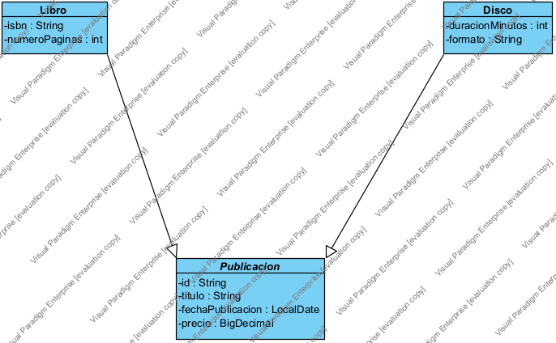
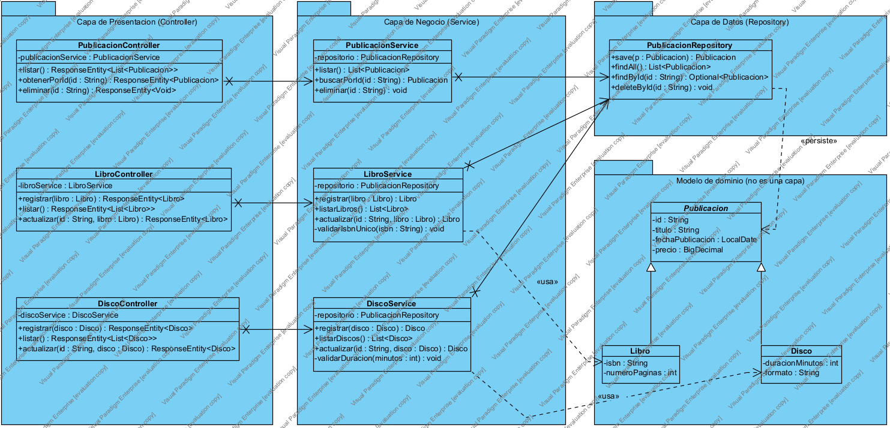

# Taller Bloque 7 · Editorial: de UML a una API REST en tres capas con MongoDB

**Universidad Cooperativa de Colombia · Campus Pasto**
**Asignatura:** Diseño de Software
**Integrantes:** Laura Sofía Meza Reinoso · Juan Diego Moreno Revelo
**Fecha:** 11 de noviembre de 2026

📄 Informe en PDF: [Informe_Taller_Bloque7.pdf](Informe_Taller_Bloque7.pdf) · 🧩 Proyecto Visual Paradigm: [Taller_Bloque7_Editorial.vpp](Taller_Bloque7_Editorial.vpp)

---

## Contenido

1. [Propósito del taller](#1-propósito-del-taller)
2. [Actividad previa sin IA (sección 8)](#2-actividad-previa-sin-ia-sección-8)
3. [Actividad opcional con IA (sección 9)](#3-actividad-opcional-con-ia-sección-9)
4. [Autoevaluación (sección 10)](#4-autoevaluación-sección-10)
5. [Contrato mínimo de la API y documentos MongoDB](#5-contrato-mínimo-de-la-api-y-documentos-mongodb)
6. [Estructura del repositorio](#6-estructura-del-repositorio)
7. [Referencias](#7-referencias)

---

## 1. Propósito del taller

Analizar cómo el modelo de clases orientado a objetos de **Editorial** (`Publicacion`, `Libro`, `Disco`) se convierte en una API REST organizada en tres capas (**Controller → Service → Repository**), y cómo MongoDB conserva sus datos. El foco está en las responsabilidades de cada capa y en la trazabilidad entre el diseño y la implementación.

### Modelo de dominio de partida



- `Publicacion` es **abstracta** y concentra los datos comunes: `id`, `titulo`, `fechaPublicacion`, `precio`.
- `Libro` y `Disco` **heredan** esos atributos y solo añaden los suyos: `isbn` y `numeroPaginas` (Libro); `duracionMinutos` y `formato` (Disco).
- La flecha con **triángulo hueco** es una **generalización (herencia)**, no una asociación ni una composición.
- **¿Por qué no repetir `titulo` y `precio` en cada subclase?** Porque duplicaríamos código y reglas: si mañana cambia el tipo de `precio` o se agrega una validación sobre el título, habría que modificar cada subclase y se podrían volver inconsistentes. Con la generalización el cambio se hace en un solo lugar y cualquier `Libro` o `Disco` puede tratarse como una `Publicacion` (polimorfismo), por ejemplo al listar todo el catálogo.

---

## 2. Actividad previa sin IA (sección 8)

### 2.1 Tres cajas: Controller, Service y Repository con las clases de Editorial



| Caja (capa) | Clases de Editorial | Responsabilidad |
|---|---|---|
| **Controller** (presentación) | `PublicacionController`, `LibroController`, `DiscoController` | Recibir la petición HTTP, leer ruta/parámetros/cuerpo JSON, validar el **formato básico** y devolver la respuesta con su código (200, 201, 204, 400, 404, 409). |
| **Service** (negocio) | `PublicacionService`, `LibroService`, `DiscoService` | Coordinar el caso de uso y aplicar las **reglas de negocio** (ej.: ISBN único, precio positivo, duración válida). |
| **Repository** (datos) | `PublicacionRepository` (un solo repositorio para la jerarquía) | Persistir y recuperar los documentos de la colección `publicaciones` en MongoDB. |
| *Modelo de dominio (no es una capa)* | `Publicacion`, `Libro`, `Disco` | Representan los datos que viajan entre las capas. |

**Lectura del diagrama:**
- La flecha **continua** (asociación) entre Controller → Service y Service → Repository indica que cada clase **conserva una referencia** a su colaborador (atributo inyectado, ej. `- libroService : LibroService`).
- La línea **punteada** (dependencia) hacia el modelo indica que las capas solo **usan** temporalmente `Libro`, `Disco` o `Publicacion`.
- Estas relaciones de colaboración **no se deben confundir** con la herencia del dominio (`Libro → Publicacion`).
- Ruta de un registro: **Cliente HTTP → LibroController → LibroService → PublicacionRepository → MongoDB**, y la respuesta vuelve por el camino inverso.

### 2.2 ¿Quién valida una regla de negocio y quién guarda un documento?

- **La regla de negocio la valida el `Service`.** Ejemplo: al registrar un libro, `LibroService` verifica que el ISBN no exista ya en el catálogo (si existe → el Controller responde **409 Conflict**) y que el precio sea mayor que cero. El Controller solo revisa que la petición venga bien formada (JSON válido, campos obligatorios presentes → si no, **400 Bad Request**); no decide reglas del negocio.
- **El documento lo guarda el `Repository`.** `PublicacionRepository` (que extiende `MongoRepository<Publicacion, String>`) ejecuta `save(...)` y MongoDB almacena el documento en la colección `publicaciones`. Ni el Controller ni el Service escriben consultas de persistencia.

Así, cada capa tiene **una sola razón para cambiar**: si cambia el protocolo de entrada, cambia el Controller; si cambia una regla, cambia el Service; si cambia la base de datos, cambia el Repository.

### 2.3 ¿Qué cambia y qué permanece si añadimos la subclase `Revista`?

**Qué cambia (se agrega):**
1. **Modelo:** nueva clase `Revista` que **hereda** de `Publicacion` y solo declara sus atributos propios (`issn`, `numeroEdicion`, `periodicidad`).
2. **Negocio:** nuevo `RevistaService` con las reglas propias de una revista (ej. ISSN válido y único, número de edición positivo).
3. **Presentación:** nuevo `RevistaController` con su ruta especializada `/api/revistas` (POST, GET, PUT).
4. **Datos (solo en contenido):** aparecen documentos nuevos con `"tipo": "REVISTA"` en la misma colección `publicaciones`.

**Qué permanece igual:**
- `Publicacion`, `Libro` y `Disco` **no se modifican** (los atributos comunes ya están en la superclase).
- `LibroController/Service` y `DiscoController/Service` **no se modifican**.
- `PublicacionRepository` **no cambia**: como trabaja con `Publicacion`, también sirve para guardar revistas.
- MongoDB, la base de datos y la colección `publicaciones` siguen siendo las mismas; no hay que migrar documentos existentes.
- `PublicacionController` sigue listando **todo** el catálogo, ahora incluyendo revistas, sin tocar su código (polimorfismo).

Conclusión: el diseño queda **abierto a la extensión y cerrado a la modificación**; añadir un subtipo implica **agregar** clases, no reescribir las existentes.

---

## 3. Actividad opcional con IA (sección 9)

**Instrucción pedida a la IA:** *"Critica la distribución de responsabilidades del ejemplo Editorial (PublicacionController, LibroController, DiscoController → PublicacionService, LibroService, DiscoService → PublicacionRepository → MongoDB)."*

**Resumen de la crítica obtenida (parafraseada):**
1. Un solo repositorio con `findAll()` devuelve libros **y** discos mezclados; se recomienda agregar consultas por tipo (ej. `findByTipo("LIBRO")`).
2. Centralizar el manejo de errores (`@RestControllerAdvice`) para traducir excepciones del Service a códigos HTTP coherentes (404, 409, 400).
3. Crear para cada Service una interfaz y una clase `Impl`, y agregar DTOs + mappers para cada subtipo.
4. Pensar en separar Libro y Disco en microservicios independientes a futuro.

### Análisis del equipo

| Recomendación | Decisión | Justificación (del equipo) |
|---|---|---|
| **Consultas por tipo en el repositorio** | ✅ **Acertada** | Si `LibroService.listarLibros()` usa `findAll()`, le llegarían también discos y tendría que filtrarlos a mano. Una consulta derivada como `findByTipo` mantiene el acceso a datos en el Repository y deja al Service solo con la regla. Respeta la separación de capas del curso. |
| **Manejo centralizado de errores** | ✅ **Acertada** | Hace explícito el **contrato** de la API (sección 3 de la guía): el Service lanza, por ejemplo, "ISBN duplicado", y un único punto lo convierte en **409 Conflict**. Evita repetir `try/catch` en cada Controller y que el Controller termine conteniendo lógica de negocio. |
| **Interfaz + `Impl` para cada Service y DTO/mapper por subtipo** | ❌ **Innecesaria para un curso introductorio** | Duplica el número de clases (de 3 a 6 services, más DTOs y mappers) sin que hoy exista una segunda implementación ni un problema real que lo justifique. Para entender Controller → Service → Repository resulta más claro trabajar con clases concretas; se puede agregar cuando el proyecto crezca. |
| *(Microservicios por subtipo)* | ❌ Fuera de alcance | Contradice lo visto: Controller, Service y Repository son **capas lógicas** que corren en el mismo proceso Java; separar en servidores no está en el escenario. |

> Nota: la crítica de la IA se usó solo como insumo; las decisiones y justificaciones son del equipo.

---

## 4. Autoevaluación (sección 10)

**1. ¿En qué se diferencian Web e Internet?**
Internet es la **infraestructura de red** mundial (cables, enrutadores, protocolos TCP/IP) que interconecta computadores. La Web es **uno de los servicios** que funciona sobre Internet: un sistema de recursos (páginas, APIs) a los que los clientes acceden mediante HTTP/HTTPS. Otros servicios de Internet que no son la Web son, por ejemplo, el correo electrónico o la conexión a una base de datos MongoDB.

**2. ¿Qué diferencia existe entre HTTP y REST?**
HTTP es un **protocolo de comunicación** basado en mensajes de petición (método, ruta, encabezados, cuerpo) y respuesta (código de estado, encabezados, cuerpo). REST es un **estilo arquitectónico** para diseñar APIs: las rutas identifican recursos (`/api/libros/{id}`), los métodos HTTP expresan la operación y las respuestas representan el estado del recurso. REST usa HTTP, pero no es lo mismo que "usar JSON" o "hacer CRUD".

**3. ¿Por qué GET y POST no tienen el mismo propósito?**
GET **consulta** un recurso sin modificarlo (es seguro e idempotente: repetirlo no cambia nada); ej. `GET /api/publicaciones` → **200 OK**. POST **crea** un recurso nuevo enviando datos en el cuerpo; repetirlo crea otro registro; ej. `POST /api/libros` → **201 Created** con el identificador. Usar GET para crear rompería el contrato y podría duplicar datos con solo recargar.

**4. ¿Qué guarda una colección de MongoDB?**
Guarda **documentos** (estructuras tipo JSON/BSON con campos y valores) relacionados; en Editorial, la colección `publicaciones` guarda documentos de libros y discos, cada uno con su `_id`. A diferencia de una tabla, los documentos de una misma colección pueden tener campos distintos (un libro tiene `isbn`; un disco, `duracionMinutos`), por eso se usa el campo `tipo` para distinguir el subtipo.

**5. ¿Qué relación UML conecta `Libro` con `Publicacion`?**
Una **generalización (herencia)**, dibujada con línea continua y **triángulo hueco** apuntando a `Publicacion`. Se lee "un Libro **es una** Publicación". No es asociación ni composición.

**6. ¿Por qué el Controller no debería implementar toda la lógica de negocio?**
Porque su responsabilidad es la comunicación HTTP. Si contiene reglas y consultas: (a) las reglas quedan atadas al protocolo y no se pueden reutilizar desde otro punto de entrada; (b) se duplican entre controladores; (c) es más difícil probarlas sin levantar un servidor; y (d) un cambio de reglas obligaría a tocar la capa de presentación. Separarlo en Service y Repository da **alta cohesión y bajo acoplamiento**.

---

## 5. Contrato mínimo de la API y documentos MongoDB

La guía pide que, antes de programar, el equipo justifique el contrato de cada operación (método y ruta, parámetros, entrada, respuesta de éxito y errores previstos).

| Método y ruta | Parámetros | Entrada (JSON) | Éxito | Errores previstos |
|---|---|---|---|---|
| `GET /api/publicaciones` | — | — | **200 OK** + lista de publicaciones | 500 |
| `GET /api/publicaciones/{id}` | `id` (ruta) | — | **200 OK** + publicación | **404** si no existe |
| `DELETE /api/publicaciones/{id}` | `id` (ruta) | — | **204 No Content** | **404** si no existe |
| `POST /api/libros` | — | `titulo, fechaPublicacion, precio, isbn, numeroPaginas` | **201 Created** + libro con `id` | **400** datos inválidos · **409** ISBN repetido |
| `GET /api/libros` | — | — | **200 OK** + lista de libros | 500 |
| `PUT /api/libros/{id}` | `id` (ruta) | libro completo | **200 OK** + libro | **400** · **404** |
| `POST /api/discos` | — | `titulo, fechaPublicacion, precio, duracionMinutos, formato` | **201 Created** + disco con `id` | **400** datos inválidos |
| `GET /api/discos` | — | — | **200 OK** + lista de discos | 500 |
| `PUT /api/discos/{id}` | `id` (ruta) | disco completo | **200 OK** + disco | **400** · **404** |

**Documentos en la colección `publicaciones`** (estrategia: una sola colección con campo `tipo`):

```json
{ "_id": "p01", "tipo": "LIBRO", "titulo": "Diseño de Software", "fechaPublicacion": "2026-03-10",
  "precio": 65000, "isbn": "978-958-00-0000-1", "numeroPaginas": 280 }

{ "_id": "p02", "tipo": "DISCO", "titulo": "Sonidos del Galeras", "fechaPublicacion": "2025-11-20",
  "precio": 42000, "duracionMinutos": 48, "formato": "CD" }

{ "_id": "p03", "tipo": "REVISTA", "titulo": "Ingeniería Hoy", "fechaPublicacion": "2026-10-01",
  "precio": 18000, "issn": "2346-0000", "numeroEdicion": 12, "periodicidad": "Mensual" }
```

**Flujo "registrar un libro":** el cliente envía `POST /api/libros` → `LibroController` interpreta y delega → `LibroService` valida reglas y prepara la publicación → `PublicacionRepository.save()` persiste el documento en MongoDB → la API responde **201 Created** con el `id`.

---

## 6. Estructura del repositorio

```
.
├── README.md                              ← este informe
├── Informe_Taller_Bloque7.pdf             ← informe completo en PDF
├── GUIA_VISUAL_PARADIGM.md                ← cómo se construyó cada diagrama en Visual Paradigm
├── Taller_Bloque7_Editorial.vpp           ← proyecto de Visual Paradigm con los 2 diagramas
└── diagramas/                             ← imágenes exportadas desde Visual Paradigm
```

Los dos diagramas que pide la guía fueron elaborados en **Visual Paradigm**:

| # | Diagrama | Sección de la guía | Tipo UML |
|---|---|---|---|
| 1 | Modelo de dominio Editorial | 5. Modelo orientado a objetos: herencia | Clases (generalización) |
| 2 | Diseño por tres capas | 6. UML de clases y organización en tres capas · 8. Actividad previa | Clases con paquetes |

---

## 7. Referencias

- Material docente: *Lectura previa Bloque 7 – Web, HTTP, REST, MongoDB y Editorial con herencia y UML por capas*, Diseño de Software.
- MDN Web Docs – HTTP: https://developer.mozilla.org/es/docs/Web/HTTP
- Spring Data MongoDB – Reference: https://docs.spring.io/spring-data/mongodb/reference/
- MongoDB – Documentación: https://www.mongodb.com/docs/
